# SuiDemo

<p align="center">
  <h1 align="center">SuiDemo</h1>
</p>

<p align="center">
  <a href="https://github.com/JinGongX/SuiDemo/blob/main/LICENSE">
    
  </a>
  <a href="https://github.com/JinGongX/SuiDemo/releases">
    
  </a>
  <a href="https://github.com/wailsapp/wails/tags" rel="nofollow">
    
  </a>
  <a href="https://visitorbadge.io/status?path=https%3A%2F%2Fgithub.com%2FJinGongX%2FSuiDemo">
    
  </a>
</p>

<p align="center">
  <a href="#简体中文">简体中文</a> ｜ <a href="#english">English</a>
</p>

---

## 简体中文

### 🎯 项目介绍

**SuiDemo** 是一个基于 [Wails v3](https://v3alpha.wails.io/) + Vue 3 + Go 构建的现代化跨平台桌面应用模板。

项目集成了常用的桌面应用功能，提供完整的前后端基础架构，帮助开发者快速启动自己的桌面应用项目，而不必从零搭建基础功能。

**主要功能：**

- 🌍 **多语言支持**：基于 vue-i18n 实现中英文切换，方便扩展其他语言。
- 🌗 **主题切换**：支持明亮 / 暗黑主题，提供更好的视觉体验。
- 🗂️ **SQLite 数据库**：集成 SQLite，提供完整的增删改查示例。
- ⌨️ **快捷键支持**：支持全局快捷键注册、配置及扩展。
- 🧠 **OCR 图像识别**：支持从图片中提取文字。
- 🔄 **应用更新检查**：支持在应用内手动检查新版本，方便用户及时获取更新。
- 🚀 **快速创建项目**：通过 Wails CLI 直接使用模板创建自己的桌面应用。

### 📢 最近更新

- 新增应用内检查更新功能，用户可以主动检查是否有新版本。
- 优化 Wails v3.1.0 兼容性，完善模板在新版本下的运行体验。
- 修复及优化部分 UI 兼容性问题，提升不同环境下的界面显示和交互体验。

### 💻 技术栈

| 模块 | 技术 |
|---|---|
| 桌面框架 | Wails v3 |
| 后端 | Go |
| 前端 | Vue 3 + TypeScript |
| UI 样式 | Tailwind CSS |
| 国际化 | vue-i18n |
| 数据库 | SQLite |

### 🚀 快速开始

#### 环境准备

请确保本地已安装以下开发环境：

- [Go](https://go.dev/dl/)
- [Node.js](https://nodejs.org/)
- [Wails v3 CLI](https://wails.io/docs/gettingstarted/installation)

#### 1. 安装 Wails CLI

```bash
go install github.com/wailsapp/wails/v3/cmd/wails3@latest
```

#### 2. 使用模板创建项目

```bash
wails3 init -n myproject -t https://github.com/JinGongX/SuiDemo
```

#### 3. 进入项目并启动

```bash
cd myproject

# 开发模式
wails3 dev
```

#### 4. 构建应用

```bash
wails3 package
```

构建完成后，可以在项目的 `bin` 目录中找到生成的应用程序。

### 🧱 项目结构

```text
SuiDemo/
├── frontend/               # Vue 3 前端代码
│   └── src/
│       ├── locales/        # 多语言资源文件
│       ├── components/     # Vue 组件
│       └── App.vue
├── internal/               # Go 后端业务逻辑
├── platform/               # 跨平台差异化实现
├── main.go.tmpl            # 应用入口模板
├── Taskfile.yml            # 项目构建配置
└── go.mod
```

### 📸 界面展示

<p align="center">
  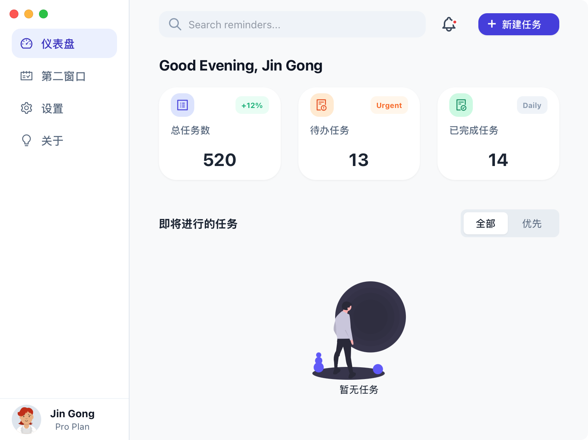
  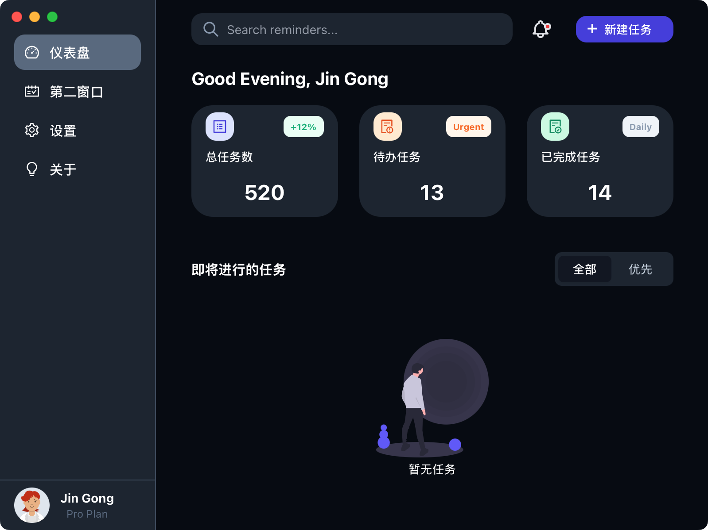
</p>

<p align="center">
  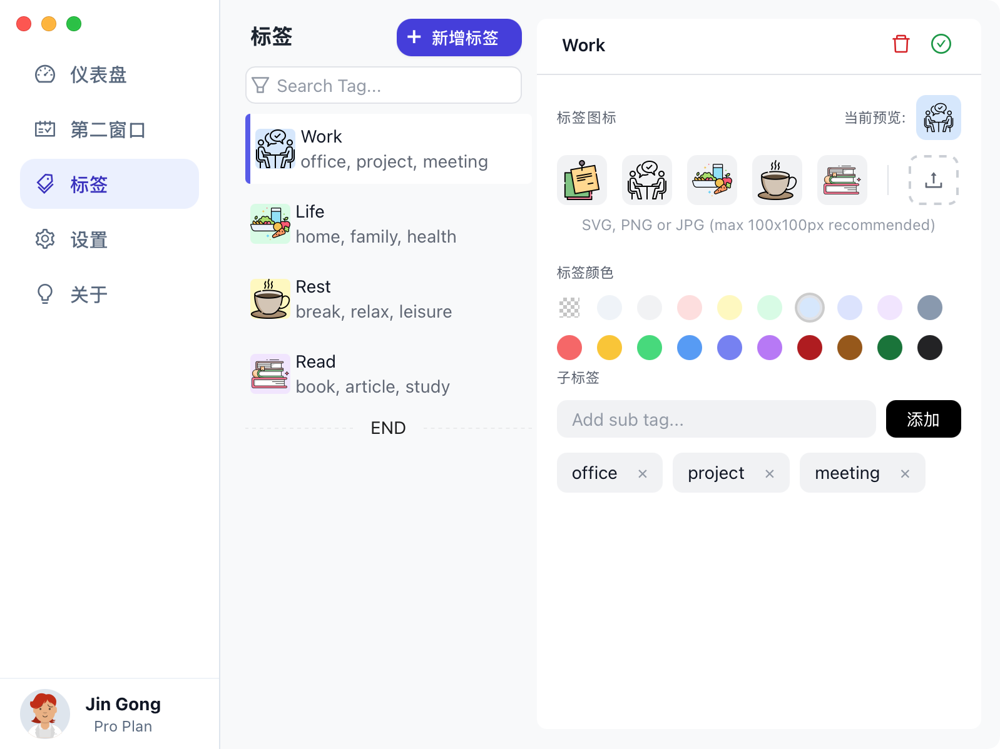
  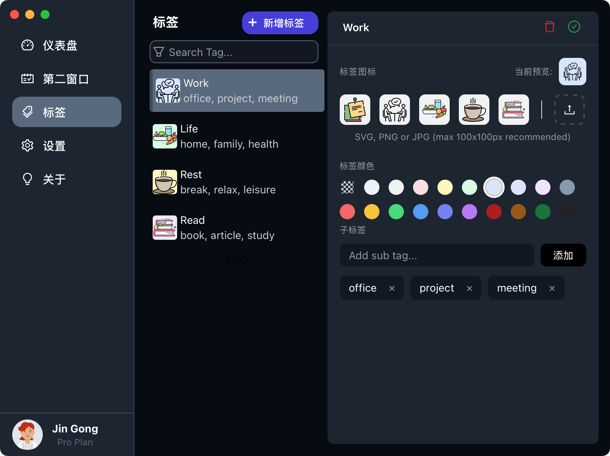
</p>

<p align="center">
  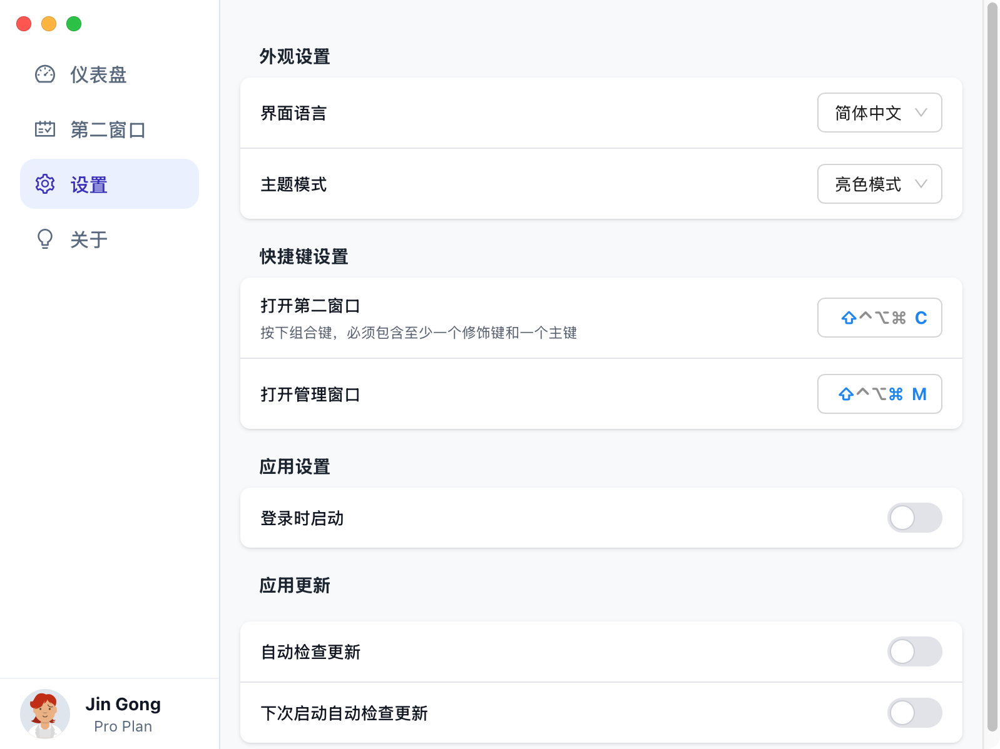
  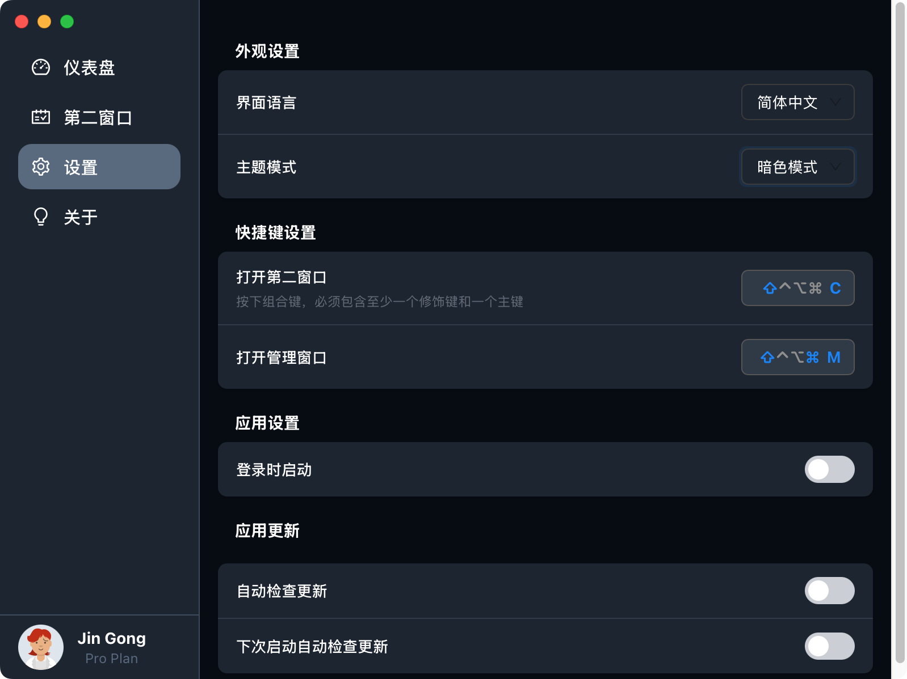
</p>

<p align="center">
  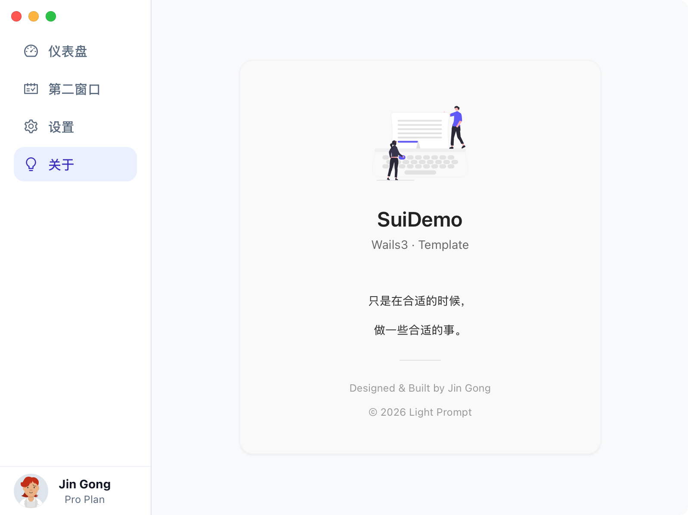
  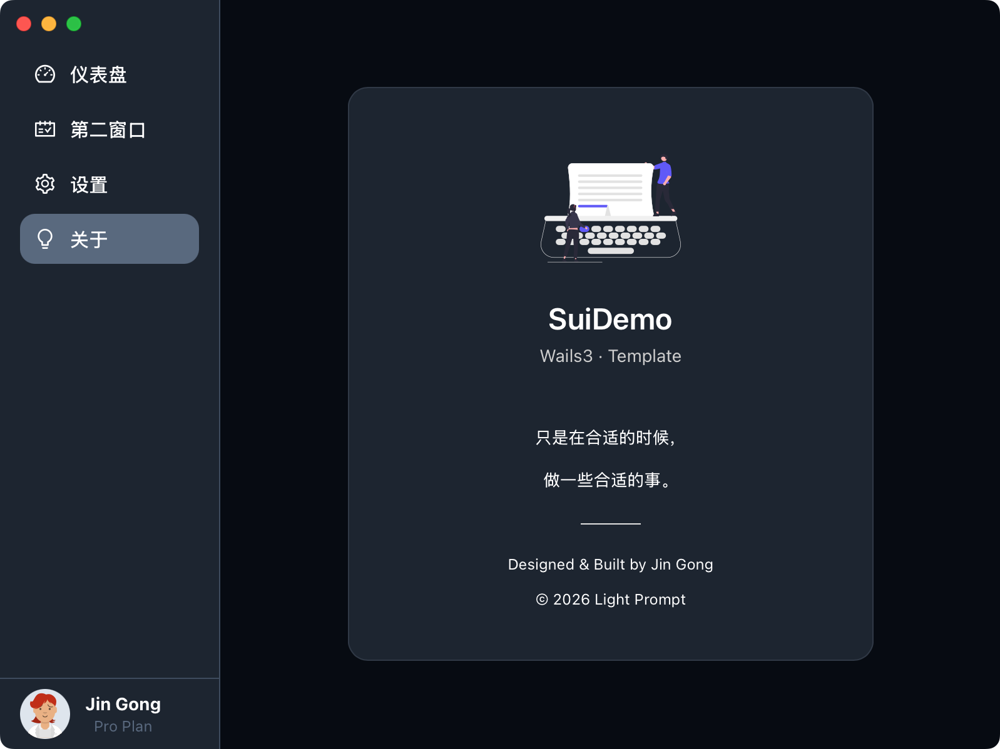
</p>

### 📜 许可证

本项目采用 [MIT License](LICENSE) 开源协议。

### 🙌 鸣谢

- [Wails](https://v3alpha.wails.io/)

### 💬 联系方式

如果你觉得这个项目对你有帮助，欢迎 Star、提交 Issue 或 PR。

Email: ggfugg8@icloud.com

---

## English

### 🧩 Project Overview

**SuiDemo** is a modern cross-platform desktop application template built with [Wails v3](https://v3alpha.wails.io/), Vue 3, and Go.

It provides a ready-to-use application foundation with commonly needed desktop features, helping developers quickly bootstrap their own desktop applications without building everything from scratch.

**Key Features:**

- 🌍 **Internationalization**: Built-in multi-language support with vue-i18n.
- 🌗 **Theme Switching**: Supports light and dark themes.
- 🗂️ **SQLite Integration**: Includes database CRUD examples powered by Go.
- ⌨️ **Keyboard Shortcuts**: Global hotkey registration, configuration, and extensibility.
- 🧠 **OCR Support**: Extract text from images.
- 🔄 **Update Checking**: Manually check for new application versions directly within the app.
- 🧱 **Extensible Architecture**: A modular Go + Vue 3 architecture designed for customization and further development.
- 🚀 **Quick Project Setup**: Create new desktop applications directly from the Wails CLI template.

### 📢 What's New

- Added in-app update checking, allowing users to manually check for new versions.
- Improved compatibility with Wails v3.1.0.
- Fixed and optimized UI compatibility issues for a more consistent interface and interaction experience.

### 📦 Tech Stack

| Module | Technology | Description |
|---|---|---|
| Desktop Framework | Wails v3 | Cross-platform desktop applications |
| Backend | Go | Backend business logic |
| Frontend | Vue 3 + TypeScript | Reactive frontend development |
| Styling | Tailwind CSS | Utility-first CSS framework |
| Internationalization | vue-i18n | Multi-language support |
| Database | SQLite + Go | Local database integration |

### 🚀 Getting Started

#### Prerequisites

Make sure you have installed:

- [Go](https://go.dev/dl/)
- [Node.js](https://nodejs.org/)
- [Wails v3 CLI](https://wails.io/docs/gettingstarted/installation)

#### 1. Install Wails CLI

```bash
go install github.com/wailsapp/wails/v3/cmd/wails3@latest
```

#### 2. Create a Project

```bash
wails3 init -n myproject -t https://github.com/JinGongX/SuiDemo
```

#### 3. Run in Development Mode

```bash
cd myproject

wails3 dev
```

#### 4. Build for Production

```bash
wails3 package
```

The generated application can be found in the `bin` directory.

### 🧱 Project Structure

```text
SuiDemo/
├── frontend/               # Vue 3 frontend
│   └── src/
│       ├── locales/        # Translation resources
│       ├── components/     # Vue components
│       └── App.vue
├── internal/               # Go backend logic
├── platform/               # Platform-specific implementations
├── main.go.tmpl            # Application entry template
├── Taskfile.yml            # Build configuration
└── go.mod
```

### 📸 Screenshots

<p align="center">
  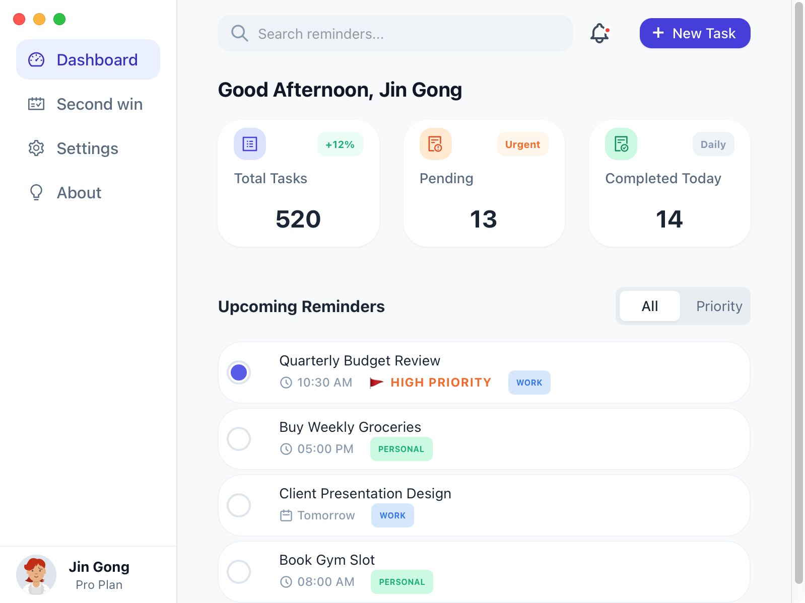
  
</p>

<p align="center">
  
  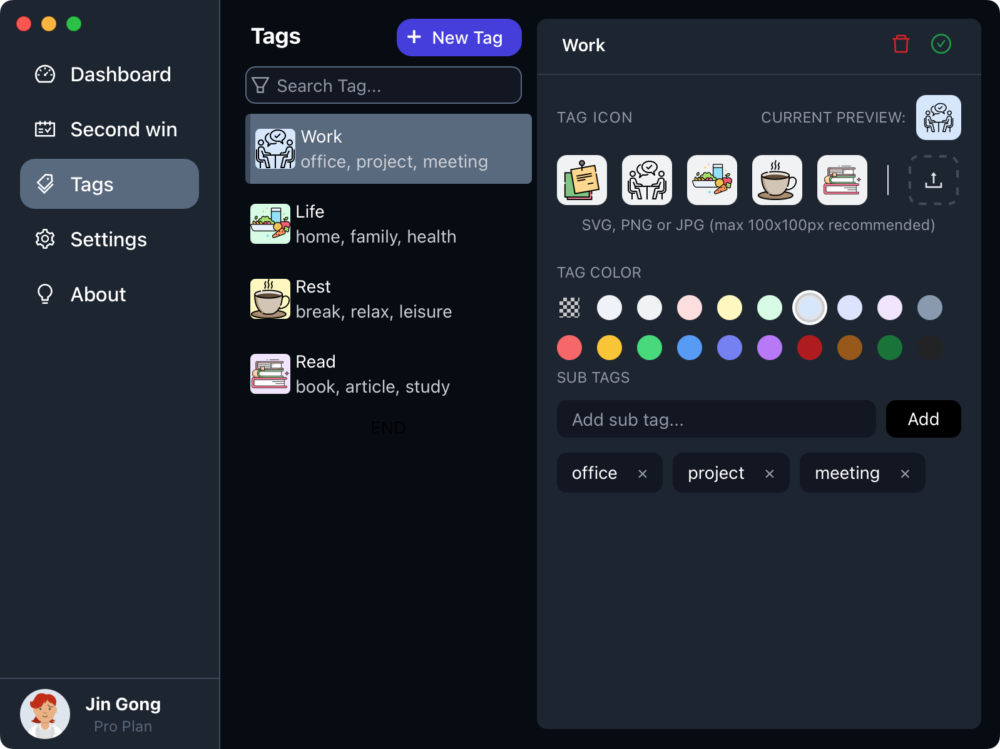
</p>

<p align="center">
  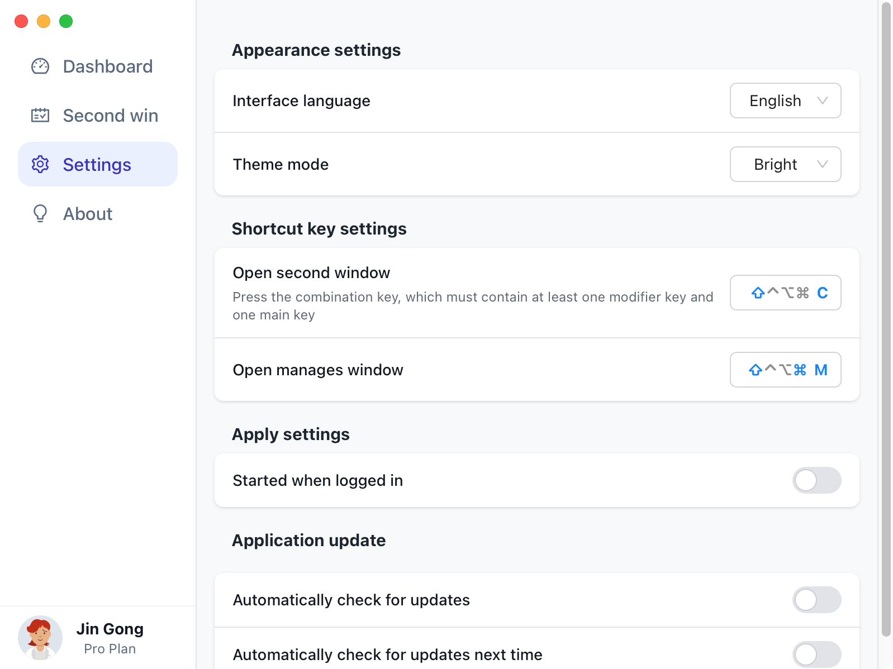
  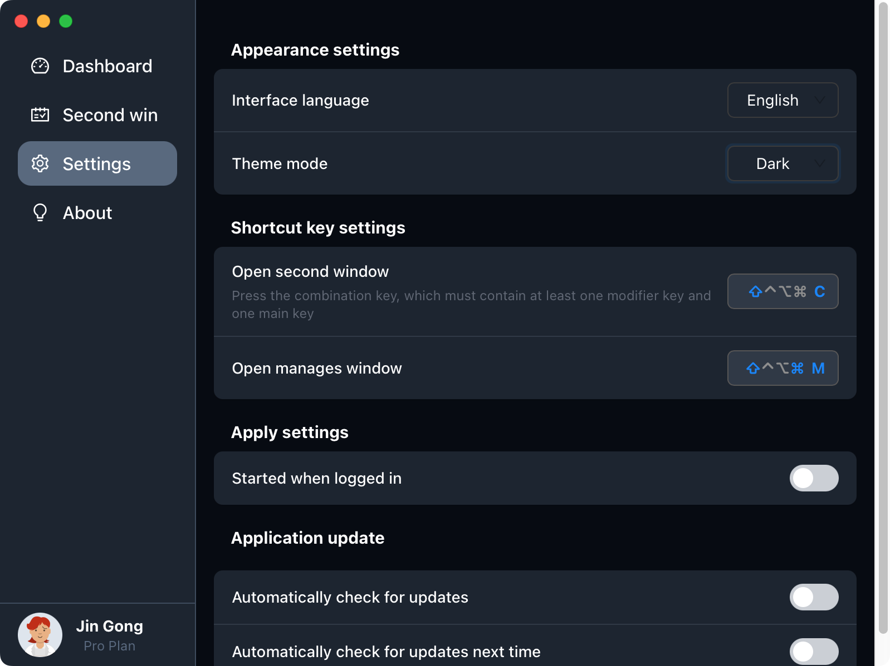
</p>

<p align="center">
  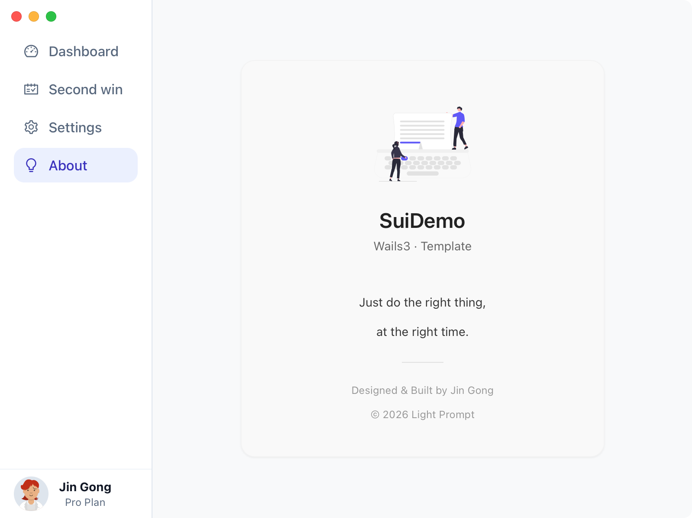
  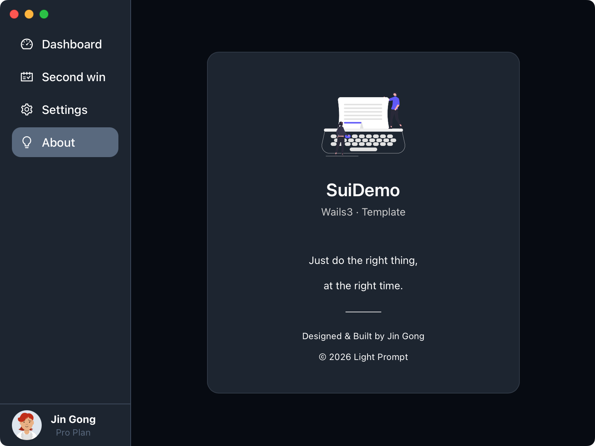
</p>

### 📜 License

MIT License.

### 🙌 Acknowledgements

- [Wails](https://v3alpha.wails.io/)

### 💬 Contact

If you find this project useful or have suggestions, feel free to open an issue or submit a pull request.

Email: ggfugg8@icloud.com

---

## ⭐ Star History

[](https://star-history.com/#JinGongX/SuiDemo&Date)
